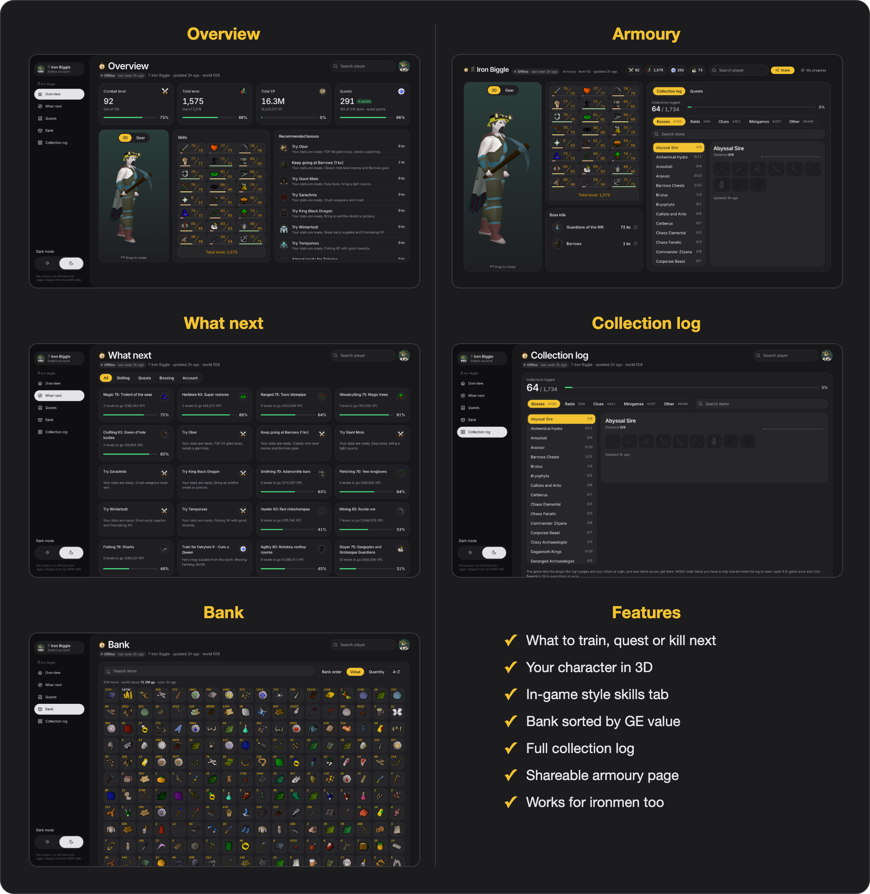
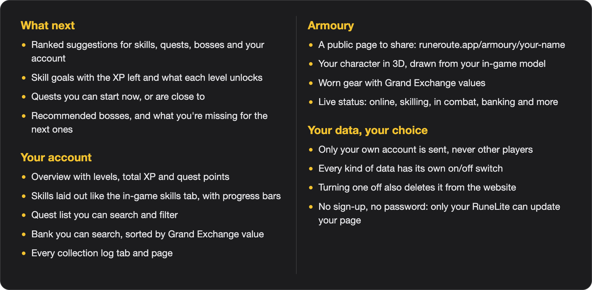

# Rune Route Sync

Links your account to [runeroute.app](https://www.runeroute.app), a free companion site that tells you what to train, quest or kill next.

Install the plugin and log in. Within a minute your page appears on the site with your stats, quests, bank and collection log, and it stays up to date while you play. There's nothing to sign up for.

- Ranked suggestions for what to do next, based on your actual account
- Your character in 3D on a public armoury page you can share
- Works for standard accounts and every ironman mode

 

  

<h2 align="center">Features</h2>

 

  

<h2 align="center">Your data</h2>

Only **your** account is sent to runeroute.app, never other players. RuneLite shows a warning on install because the site isn't run by the RuneLite developers.

While you're logged in, the plugin syncs about once a minute: your name, account type, levels and XP, quests, kill counts, gear and inventory, bank (after you open it), collection log, location and what you're doing, plus a picture and 3D model of your character when your look changes.

Every kind of data has its own switch in the plugin settings under **Data to send**. Turning one off stops sending it and deletes it from the website.

<h2 align="center">Author</h2>

You can find my socials at <a href="https://www.iotaaa.co.uk/">iotaaa.co.uk</a>.

